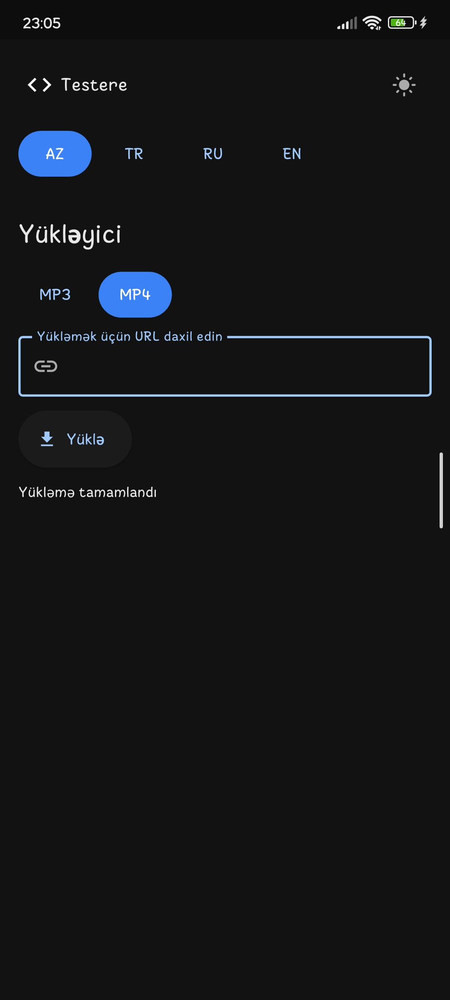

# Testere Downloader (Android APK)

**Flet** ilə hazırlanmış, **MP3** və **MP4** formatlarında media yükləmə tətbiqi (`main.py`)[cite: 1]. Repozitoriyada hazır **Android APK** versiyası təqdim olunur.

*(Şəkli repozitoriyada başqa qovluqda saxlayırsınızsa, məsələn `assets/Screenshot_2026-11-20-23-05-02-264_com.mycompany.tsmusic.jpg`, `src` yolunu ona görə dəyişin.)*

---

## Xüsusiyyətlər

* **Format seçimi (`MP3` / `MP4`):** `MP3` (`3`) və `MP4` (`4`) formatları seçilərək `Download.dow(url, cohi)` funksiyası ilə yükləmə başladılır[cite: 1]. Aktiv yükləmə zamanı format düymələri kilidlənir[cite: 1].
* **URL yoxlanışı və avtomatik təmizləmə:** Boş sahələr və düzgün olmayan `http` / `https` keçidləri bloklanır[cite: 1]. Yükləmə başlanğıcında `URL` sahəsi avtomatik təmizlənir[cite: 1].
* **Ardıcıl yükləmə:** Bir yükləmə tam bitməyənə qədər ikinci yükləmə başlanmır[cite: 1].
* **İrəliləyiş və status göstəricisi:** Yükləmə faizi (`ProgressBar`), çevirmə (`converting`), tamamlanma (`done`) və xəta (`error`) statusları ekranda göstərilir[cite: 1].
* **Mövzu və dil seçimi:** Açıq və tünd mövzu keçidi, həmçinin `settings.py` vasitəsilə dil dəyişimi dəstəklənir[cite: 1].
* **GitHub keçidi:** Üst soldakı **Testere** loqosu vasitəsilə `https://github.com/testere-development` səhifəsi açılır[cite: 1].

---

## Android-ə Quraşdırma (APK)

1. Repozitoriyanın **Releases** və ya fayl bölməsindən **Testere Downloader** `.apk` faylını yükləyin.
2. Android cihazınızda **Naməlum mənbələrdən quraşdırmaya** (brauzer və ya fayl meneceri üçün) icazə verin.
3. Yüklənmiş `.apk` faylına toxunun və **Quraşdır** düyməsini seçin.
4. Quraşdırma bitdikdən sonra tətbiqi açın.

---

## İstifadə Qaydası

1. Tətbiqi açın (istəsəniz dili və ya açıq/tünd mövzunu seçin)[cite: 1].
2. **MP3** və ya **MP4** formatını seçin[cite: 1].
3. Etibarlı `http://` və ya `https://` media keçidini yapışdırıb yükləmə düyməsinə basın[cite: 1].
4. Yükləmə və çevirmə prosesinin bitməsini gözləyin; cari proses bitdikdən sonra yeni yükləməyə başlaya bilərsiniz[cite: 1].

---

**Testere Development** · [GitHub](https://github.com/testere-development)[cite: 1]
